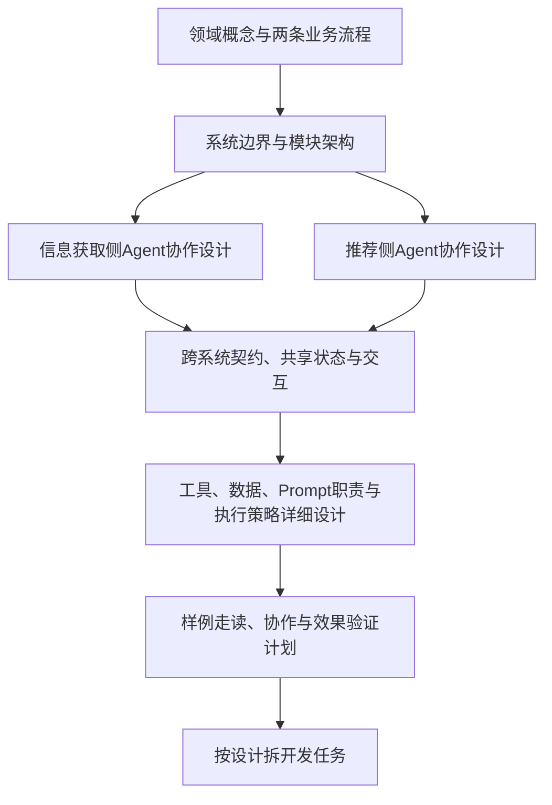

# 推免系统：多Agent系统分析与设计计划

作者：Codex（AI助手）。日期：2026-10-14（北京时间）。依据用户要求，在已确定的开发流程中补充两大子系统各自的Agent设计，以及模块、状态与交互建模。本轮制定设计顺序和交付物，不预定Agent数量、模型、框架或最终架构，不修改用户原文和PRD。

## 1. 设计工作的调整

系统包含“信息获取与资料积累”和“画像与个性化推荐”两个部分，**两部分分别设计Agent协作模块，再设计它们之间的交互**。领域模型、存储、接口和普通服务仍是共同基础。

设计分为四个视角，避免混淆：

| 视角 | 需要确定什么 |
|---|---|
| 业务／领域 | 招生机会、政策、来源、用户画像等概念与规则 |
| 系统模块 | 采集、资料管理、画像、规则判断、推荐、管理面板等职责边界 |
| Agent协作 | 哪些职责需要Agent，如何分工、调用、汇合、追问和结束 |
| Agent执行 | 每个角色能用哪些工具、看到哪些上下文、读写哪些状态、如何输出与验证 |

业务模块与Agent不是一一对应关系；一个模块可含多个Agent与普通代码。Agent角色与运行实例也不同：按院校并行执行可以复用同一角色，传入不同院校、来源入口和范围，不需要为每校维护一套独立角色设计。

## 2. 轻量调研对设计的启示

官方资料区分预定义路径的workflow与由模型动态决定步骤的Agent，支持顺序、并行、协调者／worker及评估反馈等组合。适用于本项目的设计候选是：外层明确任务与状态，内部在探索、解释和补充调查等位置允许有边界的自主决策。[Anthropic模式说明](https://www.anthropic.com/engineering/building-effective-agents)、[LangGraph说明](https://docs.langchain.com/oss/python/langgraph/workflows-agents)

“协调者调用子Agent并接收结果”与“将控制权交接给其他Agent”是不同的协作模式，涉及不同的对话所有权和上下文传递。设计时应明确采用哪一种，不能只写“Agent之间互相调用”。[LangChain多Agent说明](https://docs.langchain.com/oss/python/langchain/multi-agent)

协作需要明确任务结束、失败与循环终止方式。官方框架提供消息、时间、资源等终止机制作为参考；本项目具体预算与阈值在后续设计中设定。[AutoGen终止说明](https://microsoft.github.io/autogen/stable/user-guide/agentchat-user-guide/tutorial/termination.html)

以上是架构模式参考，不是框架选型。Anthropic文章发表于2024年，页面已提示部分工具变化；本计划使用其模式区分，不据此选择旧SDK。这里的候选分工与设计流程是本项目建议，不是来源要求。

完整轻量调研：[多Agent协作设计轻量调研](D:/Zewang/newProject/ICT/AI文档/02_前期调研/多Agent协作设计轻量调研.md)。

## 3. 下一步的设计顺序

### 第一步：领域模型与业务流程

先明确院校、院系、专业／方向、招生机会、阶段／批次、招生年度、政策／规则、原文／证据、来源入口、用户画像、判断与推荐结果的关系。

画信息获取和推荐两条业务流程，将“普通处理步骤”“Agent决策”“用户澄清”“外部工具访问”标注出来。这一步可以提出候选职责分组，但不锁定角色数量。概念模型不直接等同数据库表。

PRD v0.7已有增强建议时，沿用其状态：已确认MVP作为主线，目标机会诊断、比较与变化解释等仍标为候选，不把新增建议自动纳入正式范围。

产出：领域模型、两条活动图、关键规则与必要未决项；核心需求规格随分析补齐。

### 第二步：系统概要架构

明确两个子系统及公共能力的边界：资料与证据管理、来源访问工具、画像持久化、规则处理、任务运行与管理员告警等。

区分业务模块、Agent团队、编排器、工具和存储。决定公共复核能力如何复用，以及两个团队如何通过任务／结果协作。并行能力、状态管理和平台集成在这个层次比较，不提前将每个Agent部署为独立服务。

产出：系统架构文档、上下文／组件图、关键选型与取舍记录。

### 第三步：分别设计两套Agent协作模块

| 部分 | 候选职责分组（不是最终Agent列表） | 重点比较的协作模式 |
|---|---|---|
| 信息获取与资料积累 | 任务分解与协调、院校入口探索、资料理解与政策提取、来源复核、更新汇总 | 外层任务编排，按校并行worker，提取与复核的有界反馈 |
| 画像与个性化推荐 | 对话与画像澄清、科研突出判断、机会检索与规则理解、候选复核协调、综合分析与理由生成 | 对话协调者调用专长角色，部分步骤顺序依赖，独立候选可并行处理 |

两部分分别回答：谁接收任务、谁决定下一步、哪些能并行、哪里需要用户回答、谁汇总结果、哪里进行校验、怎样结束。比较角色合并／拆分是否改善职责清晰度、质量或效率。

确定的规则比较、日期计算、数据校验和管理员权限等，可以由普通代码或工具执行，供Agent调用；Agent负责理解、协调和需要灵活探索的任务。规则判断仍遵守PRD：不符合淘汰、个人条件未知保留标注、科研标记仅按院系放宽政策使用。

产出：两份Agent协作设计，分别包含角色职责、编排模式、调用关系、状态和关键交互图。

### 第四步：设计两个系统之间的契约

关键场景是：**推荐侧找到候选 → 请求信息侧检查对应来源 → 信息侧访问／复核／更新 → 返回政策、版本与状态 → 推荐侧重新判断并继续排序。**

这里需要明确任务范围（哪个院系／专业／年度／机会）、来源入口、待复核事项、结果与证据、资料版本和变化、成功／部分成功／无法访问等状态，以及下一步由谁执行。消息字段在后续接口设计中落地。

共享公开资料、用户长期画像、单次推荐状态和Agent自身上下文分别管理。传递当前任务需要的资料，不默认广播全部对话；明确共享资料更新和画像修改的写入归属，处理同一院校被多个任务同时复核的情况。

已确认的行为直接作为约束：无法访问标记跳过，多次失败管理告警；能读取资料但报名状态查不到者按PRD末尾提示。失败与状态未知不是同一种结果。

产出：Agent接口与共享状态设计、跨系统时序图、必要状态图。

### 第五步：详细设计与验证计划

再设计具体工具契约、可插拔来源适配、状态持久化、输出校验、复核循环、恢复与结束策略，以及Prompt职责和科研／排序方法。UML表达控制和数据关系，Prompt规范补充Agent指令边界。

先用真实官方资料样例进行纸面走读：每个Agent收到什么、调用什么、输出什么、下游凭什么继续。对关键平台能力、采集或模型质量的不确定项安排必要技术验证，不能仅靠图和文字宣称已经可行。正式产品开发仍按用户要求放在设计准备之后。

评估覆盖两个层次：单个角色输出是否有据、可解析；整条协作是否正确走到结果，失败能否按PRD处理，以及时间和调用成本是否可接受。具体阈值由设计与验证结果确定。

## 4. 每个Agent角色需要设计的内容

统一采用“角色说明卡”，避免只给名称和一段Prompt：

| 项目 | 设计内容 |
|---|---|
| 目标与边界 | 解决什么任务，哪些决定由它作，哪些必须交回编排器或用户 |
| 输入／输出 | 任务范围、所需资料、结构化结果、证据引用、未知点与失败状态 |
| 工具 | 可用工具、读写能力、调用前提和错误结果；工具可独立替换 |
| 上下文与记忆 | 当前任务材料、会话状态、长期资料分别从哪里读取、由谁更新 |
| 协作 | 调用对象、返回位置，调用后返回还是交接控制权，串并行依赖 |
| 完成与停止 | 成功标准、输出校验、重试或返工、停止与恢复条件 |
| 可观测与评估 | 任务和调用记录、证据／版本、耗时、模型与Prompt版本、角色及流程评估 |

角色数量、模型和Prompt正文在模式与边界确定后细化。复核角色应对照官方原文与来源，不以多个Agent同意代替真实性核验。网页与附件是业务资料，不改变Agent职责和工具权限。

## 5. UML与工具怎样辅助

| 图／工具 | 用在什么地方 | 要画清楚的内容 |
|---|---|---|
| 概念类图 | 领域分析 | 机会、规则、来源、画像和判断结果的关系 |
| 活动图 | 业务与Agent编排 | 分支、并行与汇合、澄清、复核反馈、失败与结束 |
| 组件图 | 系统模块与团队边界 | 两个子系统、Agent协作模块、工具、存储及依赖 |
| 时序图 | Agent交互与跨系统协作 | 消息内容、调用返回／交接、工具结果、复核后重新判断、失败分支 |
| 状态机图 | 任务、对话和复核状态 | 等待输入、执行、完成、失败、跳过和恢复；状态对象分别建模 |
| ER图 | 后续存储设计 | 数据实体、键与约束；ER图不是UML |
| 角色说明卡／契约表 | Agent内部规范 | UML难以表达的上下文范围、工具边界、输出要求和停止策略 |
| 运行轨迹 | 实现与验证 | 对照时序图检查实际调用；不会由UML本身验证模型语义正确性 |

UML没有本项目专用的内置Agent图类型。可用标签或自定义构造型标记“Agent”“编排器”“工具”“存储”，附图例，继续遵守图本身的结构与行为语义。

建议PlantUML保存源文件，输出SVG／PNG便于讨论；活动图和时序图分别表达流程与参与者消息，不互相代替。普通顺序调用、并行调用和返工循环需有相应表示。[PlantUML活动图](https://plantuml.com/activity-diagram-beta)、[时序图](https://plantuml.com/sequence-diagram)

本轮不生成最终产品架构图。现有2026-10-11早期图包含当时的平台、定时采集与人工复核假设，应重新对照当前PRD审查后再复用，不直接作为已确定架构。

## 6. 对应文档与文件组织

依已有目录分类，按阶段创建有内容的文件，不提前批量建空模板：

| 文档 | 计划位置 |
|---|---|
| 领域与信息模型、简洁SRS、业务活动图 | 05_需求分析及其PlantUML子目录 |
| 系统架构设计 | 06_架构设计/系统架构设计.md |
| 信息获取Agent协作设计 | 06_架构设计/信息获取Agent协作设计.md |
| 个性化推荐Agent协作设计 | 06_架构设计/个性化推荐Agent协作设计.md |
| Agent接口与共享状态设计 | 06_架构设计/Agent接口与共享状态设计.md |
| 数据、工具接口和两部分执行策略的详细设计 | 07_详细设计，延续既有文档规划 |
| 测试与Agent协作效果评估 | 08_测试与评估，延续既有文档规划 |

图随所属文档进入同目录PlantUML子目录，导出图与源文件对应。所有AI文档和图保留作者、日期、版本、状态及引用。需求→模块→Agent职责／普通处理→契约／图→验证场景之间保持对应关系。

**紧接着的具体工作：**先形成领域模型与两条业务活动图，并列出两部分的候选Agent职责分组；然后据此完成概要架构与两份Agent协作设计。系统模块与Agent设计相互校正，不再把Agent设计推迟为开发时临时拼Prompt。

参考输入：[当前PRD](D:/Zewang/newProject/ICT/AI文档/05_需求分析/产品需求文档_PRD.md)、[既有开发流程](D:/Zewang/newProject/ICT/AI文档/03_计划建议/软件开发流程与文档规划.md)、[文档处理规则](D:/Zewang/newProject/ICT/文档处理规则.md)。
