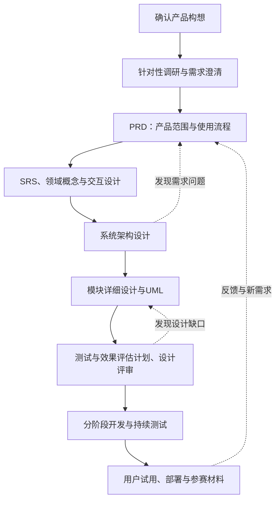

# 推免个性化推荐系统：开发流程与文档规划

作者：Codex（AI助手）。日期：2026-10-13（北京时间）。依据用户提出的“先确定流程、完成文档与UML，再开始开发”要求整理。本稿确定建议流程、文档职责和完成标准；尚未确定产品细则或技术方案，不替代用户原文，也不表示用户已经采纳。

## 1. 下一份写什么

建议下一份写 **《产品需求文档（PRD）》**，以现有One-Pager和针对性调研为输入。之后写 **《软件需求规格说明书（SRS）》**，再进入架构和详细设计。

“需求说明文档”是宽泛叫法，可能指产品需求，也可能指软件需求规格。我们明确区分两者，避免大家对同一个标题理解不同：

| 文档 | 主要读者与问题 | 本项目中的内容示例 |
|---|---|---|
| One-Pager | 团队：我们想做什么产品？ | 自动建立推免资料、画像和推荐，两部分构想 |
| PRD | 用户、老师、产品与开发成员：服务谁、解决什么、用户如何使用？ | 信息范围、年度采集、咨询过程、结果展示、首版与长期范围 |
| SRS | 开发与验证成员：系统必须表现成什么样，怎样确认达标？ | 功能编号、业务规则、输入输出、异常行为、时效和质量要求、验收条件 |
| 架构设计 | 开发成员：系统怎样分工和协作？ | 模块边界、数据流、平台集成、workflow与Agent职责、部署方式 |
| 详细设计 | 实现与测试成员：各模块具体如何工作？ | 数据结构、接口契约、采集复核策略、画像与排序机制、状态转换、失败恢复 |
| 测试与效果评估计划 | 团队与老师：如何验证正确性和真实价值？ | 功能场景、信息质量、时效、推荐质量、用户反馈、复现方式 |

本项目将PRD和SRS分开，是为复杂业务和三人协作作出的建议，并非所有软件项目都必须如此。PRD保存产品范围与用户体验的依据；SRS引用这些内容，补齐可执行的规则，不把整份PRD复制一遍。验收条件从需求阶段开始写，之后逐步细化为测试用例。

## 2. 简单调研得到的依据

- 软件生命周期包含规划、需求分析、设计、实现、测试、部署和维护；不同方法可以顺序推进，也可以迭代交叠。因此“先需求和设计，再实现”有依据，但设计发现问题时仍要返回需求修订。[IBM：软件开发生命周期](https://www.ibm.com/think/topics/sdlc)
- PRD描述产品目的、功能和行为，帮助团队形成共同理解；实现细节可以通过关联文档展开。[Atlassian：PRD](https://www.atlassian.com/agile/product-management/requirements)
- 需求是架构、设计和验证的输入，应明确、可验证，并能追溯到原始需要。验证方式宜在定义需求时开始规划。[SEBoK：System Requirements Definition](https://sebokwiki.org/wiki/System_Requirements_Definition)
- UML用于表达结构和行为；不同图回答不同问题。系统全景还可以采用C4上下文／容器视图，它们与UML互补，具体选哪些图由沟通需要决定。[OMG：What is UML](https://www.omg.org/uml/what-is-uml.htm)、[C4：Diagrams](https://c4model.com/diagrams)

下面的阶段安排、文件数量和评审标准是对本项目的裁剪建议，不是上述来源规定的唯一标准流程。这里也不声称按某一ISO标准完成认证。

## 3. 建议的完整流程

| 阶段 | 主要工作 | 产出与进入下一阶段的依据 |
|---|---|---|
| 0. 构想共识 | 核对两部分产品、软件工程试点和长期专业扩展方向 | One-Pager得到确认；未决问题记录下来，不伪装成决定 |
| 1. 调研与澄清 | 用户任务、院校信息类型与来源样例、国内同类方案、平台与赛制约束 | 能用真实任务和资料解释主要需求；未验证的竞品／平台能力明确标注 |
| 2. 产品需求 | 定义用户、场景、信息范围、首版能力、交互主线与产品价值 | PRD；范围与主要业务问题讨论清楚，可继续技术分析 |
| 3. 需求分析 | 需求编号与规则、术语、推荐粒度、异常、质量要求；同时完善交互 | SRS、领域与信息模型、交互设计；关键需求可验证，名词和行为一致 |
| 4. 架构设计 | 模块划分、数据流、Agent／workflow分工候选比较、华为平台集成、部署 | 架构设计和决策记录；每项首版需求有归属，外部依赖有可行性证据 |
| 5. 详细设计 | 分别细化采集复核与推荐两部分，形成数据、接口和操作流程 | 详细设计、接口、数据、UML；正常和主要失败路径能完整走通 |
| 6. 开发准备评审 | 对照需求检查设计；完善测试、数据质量与AI效果验证；拆分实施任务 | 设计基线、测试计划、开发任务；满足第8节标准后开始正式实现 |
| 7. 开发与测试 | 按已确认设计实现；先打通端到端流程，再扩大覆盖；持续验证 | 可运行版本、测试与评估记录；实现变化同步回文档 |
| 8. 试用与交付 | 用户与老师反馈、缺陷修复、部署、操作说明、演示和参赛材料 | 发布版本、反馈记录、实际评估结果和可复现演示 |

阶段表示主顺序，不要求每个阶段都开一次正式会议。交互和领域分析可以与SRS一起迭代；测试计划可以随需求和设计同步完善。开发后的改动依然更新需求与设计，不把开发前的版本永久冻结。

按用户当前要求，正式产品开发放在设计评审之后。对于采集可行性、平台限制、AI质量等无法仅靠文档确认的事项，先做资料核验和真实样例分析；若仍需最小技术实验，单独讨论其验证目的与范围，不把未做实验的假设写成已验证结论。

## 4. 文档清单与各自应写到什么程度

以下是计划产出，不表示已经完成；按阶段创建有实际内容的文件，暂不批量生成空模板。

| 顺序 | 文档／位置建议 | 必须包含的内容 |
|---|---|---|
| 已有 | `00_产品构想/推免个性化推荐系统_OnePager.md` | 产品目标、两部分构想、初始范围、待讨论问题；当前仍是讨论稿 |
| 1 | `02_前期调研/需求与信息来源调研.md` | 用户真实任务、资料样例、主要来源、信息可获取性、跨专业差异、已知与未知；引用已有竞品和平台报告 |
| 2 | `05_需求分析/产品需求文档_PRD.md` | 背景与目标、用户角色、典型场景、首版及长期范围、采集与推荐能力、用户流程、结果形式、业务原则、成功指标、待确认项 |
| 3 | `05_需求分析/软件需求规格说明书_SRS.md` | 有编号的功能与质量需求、前后置条件、业务规则、输入输出、异常行为、约束、验收条件；引用PRD对应章节 |
| 4 | `05_需求分析/领域与信息模型.md` | 院校、院系、专业、招生项目、年度、通知、来源、用户画像、推荐结果等候选概念的定义与关系；确认推荐对象和年度口径 |
| 5 | `05_需求分析/交互与页面设计.md` | 页面／对话入口、画像补全与修改、推荐与理由展示、来源查看、采集任务入口；等待、失败、信息不足等状态与线框图 |
| 6 | `06_架构设计/系统架构设计.md` | 系统边界、模块职责、数据流、外部服务、华为技术的实际职责、Agent与workflow选择、部署、质量保障、关键取舍 |
| 7 | `06_架构设计/设计决策记录.md` | 问题、备选方案、选择依据、验证证据、结论和影响；未定方案标待定 |
| 8 | `07_详细设计/信息获取与复核设计.md` | 首次发现、入口复用、年度任务、采集解析、校验、去重与版本、时效检查、任务状态、重试与恢复、扩展专业的方法 |
| 9 | `07_详细设计/画像与推荐设计.md` | 画像更新、缺失信息、候选检索、资格与偏好关系、候选复核、排序及权重、推荐理由、证据与不确定性、反馈使用方式 |
| 10 | `07_详细设计/数据与存储设计.md` | 在领域模型之后定义字段、约束、来源关联、年度与版本、时间语义、索引／检索、访问权限、备份与保留规则 |
| 11 | `07_详细设计/接口与工具契约.md` | 前后端及模块接口、Agent工具输入输出、状态／错误、超时、幂等、权限、样例；只覆盖实际采用的工具与协议 |
| 12 | `08_测试与评估/测试与效果评估计划.md` | 功能与端到端场景、采集与信息质量、时效、推荐及理由质量、AI失败场景、性能成本、用户价值验证、通过标准 |
| 13 | `08_测试与评估/需求设计验收追踪表.md` | 每项需求对应PRD来源、设计章节、图、验证方式／用例及状态；开发后补实际结果 |
| 14 | `09_开发与交付/实施计划.md` | 从已确认设计拆任务、依赖和分工，形成里程碑；按团队投入及已核实的材料截止安排 |

操作／部署说明、试用反馈和参赛材料在实现过程中写，留在`09_开发与交付/`及相应功能目录。设计阶段可以先确定其所需证据，不能提前编造部署成功、用户效果或社区反馈。

文件夹编号服务于查找，不代表严格日程。现有`04_设计草案/PlantUML/`继续保留为早期参考；重新审查与当前需求的对应关系后再决定哪些复用，不能仅因已有图就认定架构已定。

## 5. UML与其他图怎么安排

图与正文一起设计，每张图应注明作者、日期、状态和对应需求／章节。PlantUML源文件放在所属阶段的`PlantUML/`子目录，确认后生成可查看的SVG或PNG，正文引用；导出前检查语法，导出后检查内容与显示效果。

| 图 | 阶段 | 主要表达的问题 |
|---|---|---|
| 用例图 | PRD／SRS | 用户咨询、画像调整、查看推荐、启动年度采集等由谁发起，系统范围是什么 |
| 活动图 | SRS／详细设计 | 信息采集、复核留存，以及画像→候选→复核→推荐两条业务流程和分支 |
| 概念类图 | 领域分析 | 院校、院系、专业、招生项目、通知、来源等如何关联；此时不锁定数据库表 |
| 组件图 | 架构 | 模块的职责、依赖和接口；Agent的数量与分工由方案比较决定 |
| 时序图 | 详细设计 | 首次采集、年度复用、咨询推荐、候选复核等关键交互；体现失败与超时分支 |
| 状态机图 | 详细设计 | 采集任务、资料复核状态等如何变化，哪些事件触发转换和恢复 |
| 部署图 | 架构／部署设计 | 页面、服务、存储、编排平台和模型服务实际运行在哪里、如何连接 |
| 实现类图 | 详细设计，按需 | 只有复杂对象协作确实需要时，再画实现层类型与职责 |
| ER图 | 数据设计 | 持久化实体、键、约束和关系；ER图不是UML |
| 系统上下文／容器图 | 架构，按需 | 系统、用户、外部来源与平台的全景；C4不是UML，也不把“容器”直接等同于Docker |
| 页面线框／用户旅程 | 交互设计 | 使用过程和页面信息层级；不属于UML |

以上是候选图清单；按需拆图或合图，不为凑齐图类型增加重复材料。顺序是从需求得出图，再用图检查缺口，不能先画固定技术架构再反过来限定产品。

## 6. 本项目需要重点详细设计的事项

### 信息获取与年度复用

先定义“相关信息”和覆盖范围，再调查院校与院系入口、通知正文与附件等真实材料。设计应明确首次探索、已知入口复用、失效入口重新发现，以及年度资料组织。跨专业扩展既要有通用信息骨架，也要允许不同专业的条件与信息来源差异；不能把软件工程字段当作全专业固定规则。

需要区分抓取成功、解析成功和信息复核通过。每校安排采集Agent、另设复核任务是用户提出的候选方法；是否采用及具体分工在架构阶段比较。“另一个Agent同意”本身不能作为真实正确的充分依据，还要说明如何对照原文和来源检查。

### 复核与时效

年度采集、推荐时候选复核是已提出的两种触发。是否还需要周期更新，留给需求讨论。分别定义来源发布时间、采集时间、成功复核时间；访问过网页不自动等于核实过相关政策。

“一天”是讨论中的阈值，后续结合实际需求、更新规律、可用性与成本确定；设计应说明检查范围、发现变化的处理，以及来源无法访问时的输出策略。一次成功复核也不意味着之后信息永远没有变化。

### 用户画像与推荐

明确用户主动填写、对话补全、个人信息修改和缺失信息的处理。讨论院校展示与院系／专业／项目匹配的关系；确认资格条件和偏好加权各自如何作用，不能未经讨论将所有约束都混为权重。

排序设计应能解释维度、权重、数据依据和不可比较／未知值的处理。理由需要与该用户和该候选对应，能追溯来源。对Agent、规则和模型的职责做明确分工；不把“使用multi-agent”本身当作推荐效果的证明，也不预设未经验证的录取概率。

### 质量、评估与实际使用

覆盖度必须先定义院校／专业／信息类型和时间窗口，再说明分母与人工核查样本；不能以获取数量直接证明“全网无遗漏”。时效、准确性、理由有据、推荐适配、响应时间与调用成本各自有验证口径。指标目标在讨论和可行性分析后确定，当前不填任意数值。

确定官方资料核查样本、历史通知样本、用户任务与老师评阅方法；历史回放和当前实时场景的验证范围分开记录。AI或模型评价可以辅助，但事实核验应对照来源，用户价值还需要真实使用反馈。成绩、偏好等个人信息的访问与处理边界写进需求和设计。

### 华为平台与参赛

赛题选择仍需团队确认。选择赛题2时，架构须说明AgentArts在构建、编排、部署及效果验证中的真实作用；选择其他赛题则按对应规则调整。账号、配额、部署与工具接入能力应核实，不能把网页资料中的能力当作本团队已经获得的资源。

赛事材料引用工程文档中的场景、架构、流程、数据与验证结果，避免再写另一套不一致的方案。本稿赛事约束来源为用户提供的[规则原文](D:/Zewang/newProject/ICT/前期讨论/ICT创新赛赛道与规则.txt)，不是新的赛事公告核验；提交前再查最新通知与模板。

## 7. 需求、设计和验收如何保持一致

SRS给需求编号，例如`REQ-ACQ-001`表示采集需求、`REQ-REC-001`表示推荐需求；`NFR-...`表示质量要求。每项记录来源、描述、前提、输入输出、业务／异常规则、优先级、验收条件和未决项。前缀是管理建议，并非已确定的需求目录。

追踪表示例（只展示格式，下面的需求和编号尚未定稿）：

| 需求ID | 需求摘要 | 来源 | 设计位置 | 图 | 验证方法 | 状态 |
|---|---|---|---|---|---|---|
| REQ-ACQ-001 | 信息记录应关联其来源URL | One-Pager第一部分 | 采集复核设计、数据设计 | 采集活动图／领域图 | 抽查记录和原文，检查对应关系 | 待细化 |
| REQ-REC-001 | 输出与用户画像对应的推荐理由 | One-Pager第二部分 | 画像与推荐设计 | 推荐时序图 | 检查用户条件、候选事实与理由是否一致 | 待细化 |

当需求或设计改变时，记录原因，检查它影响哪些接口、图与验收用例，再同步更新。作者、版本和讨论状态遵守[文档处理规则](D:/Zewang/newProject/ICT/文档处理规则.md)。AI写完不自动等于团队确认，讨论也不需要重复审批同一个已确认决定。

## 8. 怎样算“设计搞定，可以开发”

正式开发前，至少做到：

1. 产品范围、关键用户流程与核心业务规则达成共识，首版与长期扩展有明确区分。
2. 每项首版需求有可验证的描述，并对应到设计和验证方法；关键阈值有依据和明确结论。
3. 信息获取与推荐两条主线的输入、输出、职责、数据、接口和状态能对齐。
4. 信息缺失、来源失败、候选条件不足、复核过期／变化、模型输出不可用等主要异常有处理方案。
5. UML与正文一致，关键交互能从用户动作走到结果，来源和复核链条能说明清楚。
6. 华为平台、模型和外部来源等影响架构的依赖有可行性证据；阻塞首版的假设已解决，或形成团队认可的替代方案。
7. 数据质量与AI效果评估有样本、方法和通过标准；用户试用有收集反馈的方式。
8. 开发任务由设计拆出，依赖关系和分工明确。影响首版的关键未决项已解决；非阻塞问题记录影响与后续处理安排。

“详细设计”优先把业务规则、数据语义、接口、状态、异常和评估写清楚。未来所有专业的完整需求、每个代码函数、每条Prompt的最终措辞不需要在此时全部定死；保留后续迭代，同时为扩展设计明确边界。

## 9. 紧接着如何推进

本轮只提交流程与文档规划供讨论，没有创建完整PRD、SRS或新的产品架构图。

建议紧接着从PRD开始，先完整整理已提出的功能，再把影响产品范围的未决问题集中列出：信息类型、推荐粒度、初始院校名单、用户画像范围、更新／复核期望、结果展示与首版能力。针对这些问题补调研样例并修改PRD，讨论清楚后逐步完成上述设计文档。

参考输入：[One-Pager](D:/Zewang/newProject/ICT/AI文档/00_产品构想/推免个性化推荐系统_OnePager.md)、[既有调研计划](D:/Zewang/newProject/ICT/AI文档/03_计划建议/前期调研与分析设计计划.md)、[平台与赛制核验](D:/Zewang/newProject/ICT/AI文档/02_前期调研/平台与赛制核验.md)。这些材料各自保留原状态，本稿不将用户尚未审阅的建议宣布为正式决定。
