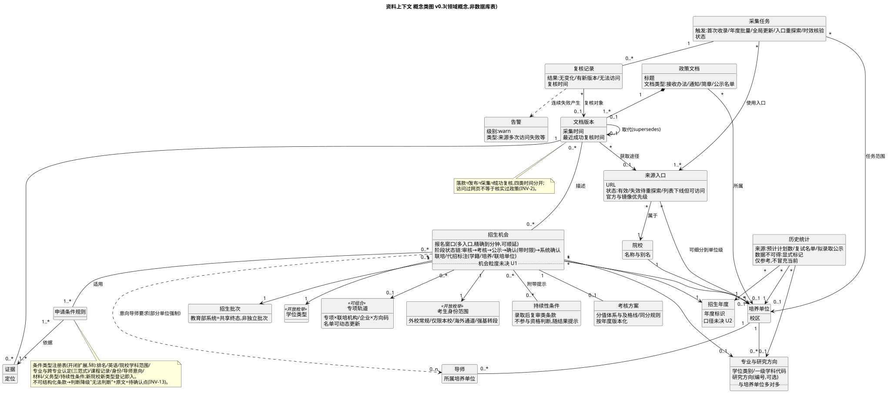
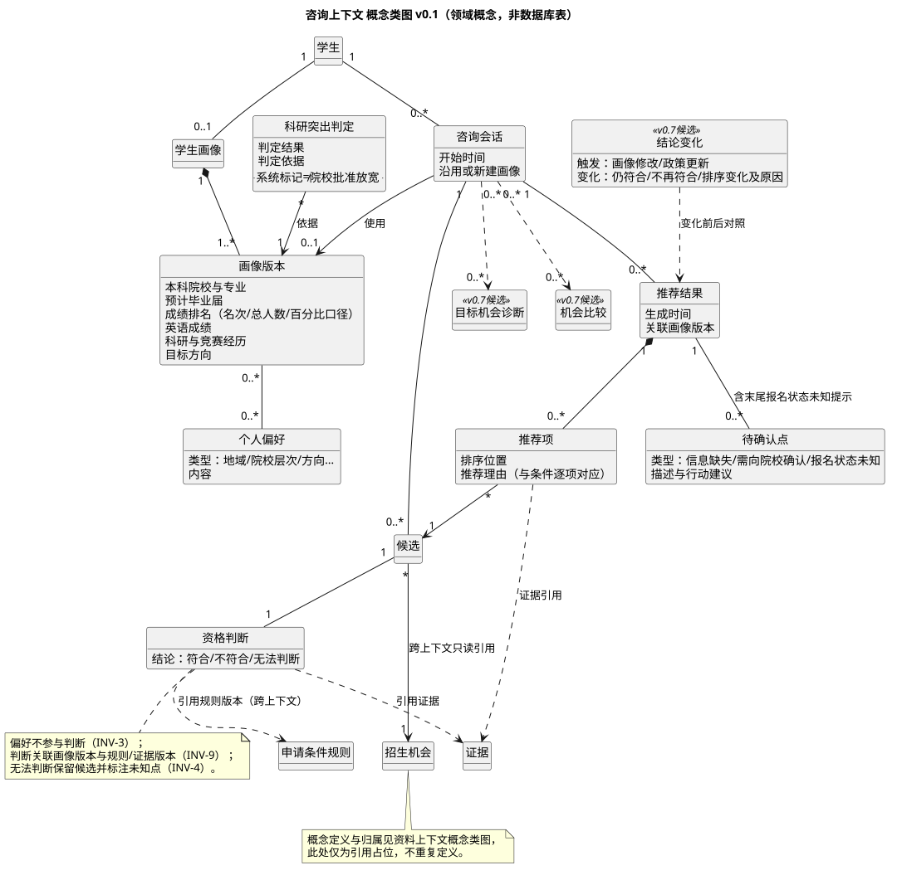
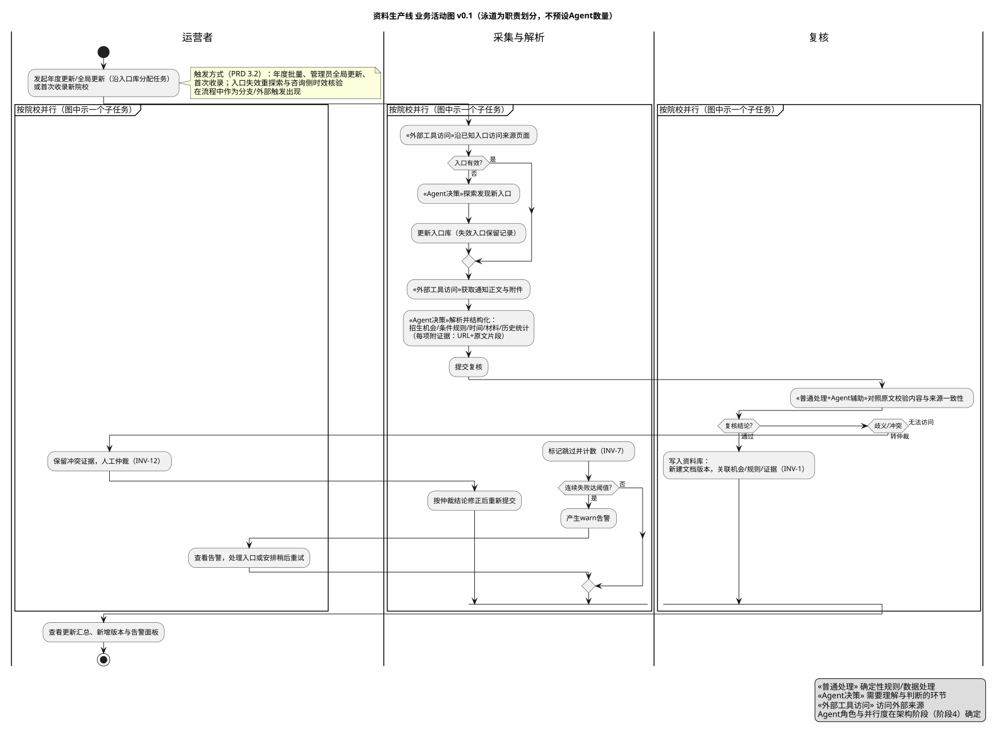

# 推免个性化推荐系统 · 领域与信息模型

作者:ZCode(AI助手)。日期:2026-10-23(北京时间)。本稿是阶段3(需求分析)的第一份产出,按《多Agent系统分析与设计计划》第一步要求:领域概念、两条业务流程、关键规则与未决项。方法依据见[OOAD与UML领域建模方法调研](../02_前期调研/OOAD与UML领域建模方法调研.md)。

**v0.2 修订说明**:依据[五校真实政策核验](../02_前期调研/代表性院校推免政策核验_建模覆盖度.md)(清华/上交/南大/新型高校/中科院计算所,2027级官方通知)修订:培养单位泛化、招生机会多轴化、条件类型开闭框架、批次项目化与机会阶段状态机、导师与考核方案入模,并新增第8节扩展性设计。本稿为草稿,经团队确认后才作为 SRS 与架构设计的输入。

## 0. 读图须知

- 概念类图是**领域概念的表达,不是数据库表设计**(Larman:领域模型≠数据模型);属性只列领域上有意义的描述,存储字段、主外键、索引留到《数据与存储设计》。
- 图中标注「v0.7候选」的概念来自 PRD v0.7 增强建议,**未采纳前不进入 MVP 基线**。
- 英文候选名供后续代码与接口命名参考,非最终命名。
- 图源文件在本目录 `PlantUML/` 子目录,SVG 导出图与源文件同名并存;2026-10-23 已应用户要求导出供预览,**图的正式确认仍待审阅**。

## 1. 上下文总览

按 DDD 限界上下文划分,系统分为两个上下文加一个由资料上下文拥有、咨询上下文只读的共享资产:

| 上下文 | 职责边界 | 拥有的核心概念 |
|---|---|---|
| **资料上下文**(信息获取与资料积累) | 发现、获取、解析、复核、留存各院校推免公开资料;维护入口库;响应咨询侧的时效核验请求 | 院校与培养单位结构、来源入口、政策文档与版本、证据、申请条件规则、招生机会、学位类型/专项轨道、导师、考核方案、采集任务、复核记录、告警 |
| **咨询上下文**(画像与个性化推荐) | 对话构建画像、科研突出判定、候选检索、资格判断、排序与推荐解释、变化解释 | 学生画像、咨询会话、科研突出判定、候选、资格判断、推荐结果、待确认点、结论变化 |
| 共享资产:已复核资料库 + 可复用入口库 | 资料上下文**唯一写入**(经复核);咨询上下文只读引用 | —— |

跨上下文的关键协作(细节在阶段4《Agent接口与共享状态设计》落地):**咨询侧产生候选 → 请求资料侧时效核验 → 资料侧访问/复核/必要时更新版本 → 返回政策、版本与状态(成功/部分成功/无法访问) → 咨询侧重新判断并继续排序。**

!概念总览图:[SVG](PlantUML/01_领域总览.svg) · 源文件 [01_领域总览.puml](PlantUML/01_领域总览.puml)

## 2. 统一词汇表(统一语言)

同一术语在全项目文档与代码中保持此处的唯一含义;发现歧义先改本表再改其他文档。

| 术语 | 英文候选名 | 上下文 | 定义与口径 |
|---|---|---|---|
| 推免 | Postgraduate Recommendation | 背景 | 应届本科毕业生经推荐免试攻读研究生;本文档一切"申请"均指推免申请 |
| 院校 | Institution | 资料 | 招生主体(大学),以研究生院为信息权威入口;别名需归一 |
| 培养单位 | AdmittingUnit | 资料 | 院校内**实际制定与执行接收政策的单位**,类型开放:学院/系/研究所/研究中心等(上科大按"院所"、中科院按"研究所"、南科大"系"与"学院"并存);**政策以培养单位为最小差异单位**;带别名(一名多牌)、校区、组织沿革(拆分/合并/新设,按年度有效——上交电院2025拆分为四学院为实证) |
| 专业与研究方向 | Program & ResearchDirection | 资料 | 培养单位招生的学科专业(一级学科/专业学位类别,如085405)及可选的研究方向层(编号01-28等);**专业-培养单位是多对多**(085405同时在南大三个学院招生),归属关系由招生机会承载,不预设单一归属 |
| 招生年度 | AdmissionYear | 资料 | 一次完整招生周期的时间归属。**口径未决(见 U2)**:按入学年份还是通知发布年 |
| 招生批次 | AdmissionRound | 资料 | 同一年度内的申请窗口,**项目化表达**:官方名称+类型开放枚举(夏令营/预推免/正式接收/调剂/补录/加推/第二轮/品牌项目如"春闱计划""计算未来暑期研修班"/校级组合批次如"重要专项")。批次**可消亡**(南大计算机停办夏令营)且**彼此间存在资格传递**(免报/位次失效/转报重考);教育部推免服务系统是所有批次的**共享终态环节**,不建为独立批次 |
| 招生机会 | Opportunity | 资料 | **推荐与资格判断的原子对象**,由培养单位×专业(×研究方向)×招生年度×招生批次定位,并带三个正交轴:**学位类型**(学硕/专硕/直博/硕博连读)、**专项轨道**(工程硕博/集成电路班/国优/创芯联培/退役士兵/少干等,开放枚举)、**考生身份范围**(本校/外校/海外/强基转段等);同一批次下不同轴组合的条件、考核与开放对象可以完全不同(粒度口径见 U1);联合培养/代招机会标注学籍单位/培养单位/联培单位(中科院代招、中关村联培为实证) |
| 学位类型 | DegreeType | 资料 | 机会的学位轴:学术硕士/专业硕士/直博/硕博连读;新式组合真实存在(上科大专硕含直博、创芯硕士2年制),不与"学制"绑定 |
| 专项轨道 | SpecialTrack | 资料 | 与学位类型正交的招生通道:国家或校级专项(工程硕博士培养改革专项、集成电路产教融合专项班、国优计划、上海创芯联培、医工交叉、国家卓越工程师等);有自己的报名通道、考核与录取规则(如南大工程硕博"入选后不得放弃") |
| 考生身份范围 | ApplicantScope | 资料 | 机会面向的考生身份:常规外校/仅限本校(上交多学院直硕仅限本校)/海外通道(清华GPA≥3.5)/强基转段(平行通道,不走普通推免流程);身份影响材料要求(清华本校生免推荐信/排名证明)与门槛 |
| 意向导师 | IntendedSupervisor | 资料 | 报名流程中的导师维度:部分单位强制填报1-3位意向导师(上科大学硕、南科大材料系)、直博须导师同意或互选协议(上科大/上交/南大)、导师有"不招收直博生"等个体属性、导师≠名额;导师信息是**申请流程要求**,"按导师推荐"仍属PRD后续版本,两者分开 |
| 申请条件规则 | EligibilityRule | 资料 | 机会适用的条件条款,按**开放的条件类型注册表**表达(见 §8):类型枚举涵盖排名/英语/院校或学科范围/专业范围(含跨专业认定)/课程记录/身份/导师意向/材料/义务型(不得放弃/不可兼报)/**持续性条件**(录取后复审类)等;每条规则标注**判定方式**(可自动判定/需裁量认定/无法结构化→降级);放宽条款区分**确定性放宽**(如C9)与**裁量性放宽**(如科研突出经院系认定);规则必须可溯源到证据 |
| 考核方案 | AssessmentPlan | 资料 | 机会的考核结构化描述:形式组合(机试/笔试/面试/英语笔试/加试)、分值体系、及格线、同分规则、差额比例(可为区间)、资格门禁(如英语笔试不通过不得进面试);**考核组织方可≠招生单位**(南大重要专项"牵头考核学院") |
| 历史统计 | HistoricalStatistics | 资料 | 官方可查证的历史数据,三类来源:预计招生/推免计划数(国科大目录)、复试/入围名单(南大469人公示)、拟录取公示名单(多为PDF,公示有时限);**报录比/入营数普遍不披露**,支持"数据不可得"标记;仅供当前推荐参考,不冒充当前政策 |
| 来源入口 | SourceEntry | 资料 | 可跨年复用的官方入口,**类型开放**:通知列表页/招生网/报名系统(≠通知页)/第三方表单(金数据,流程环节)/信息公开网(法定公示渠道)/公众号;含有效性状态(有效/失效待重探索/**已从列表下线但URL仍可访问**);官方与第三方镜像需优先级标注 |
| 政策文档 | PolicyDocument | 资料 | 一份官方材料(接收办法、通知、简章、公示名单),可跨年度存在多个**文档版本** |
| 文档版本 | DocumentVersion | 资料 | 政策文档的一次具体内容状态,带版本链(取代关系);**时间必须区分**:来源发布时间(注意文件落款日≠官网发布日)、采集时间、最近成功复核时间;同一URL内容可被更新(上交"更新"标注实证),需内容快照而非仅URL;访问过网页≠核实过政策 |
| 证据 | Evidence | 资料 | 支持某条规则/结论的官方原文片段及其定位(含PDF附件/扫描件中的定位);仅有 URL 不等于依据充分;正文藏于附件或扫描件不可机器读时,证据保留人工摘录状态 |
| 采集任务 | AcquisitionTask | 资料 | 一次资料获取工作单元,触发方式:首次收录、年度批量、管理员全局更新、入口失效重探索、咨询侧时效核验请求 |
| 复核 | Review | 资料 | 资料入库前及更新时,对照原文校验内容与来源一致性的动作;复核结果:无变化/有新版本/无法访问 |
| 告警 | Alert | 资料 | 面向运营者的异常通知(如来源多次访问失败,warn 级) |
| 学生画像 | StudentProfile | 咨询 | 一名学生的情况快照集合,按**画像版本**演进;每次新对话先询问是否修改 |
| 画像版本 | ProfileVersion | 咨询 | 一次画像内容状态:本科院校/专业、毕业届、排名(名次/总人数/百分比口径)、英语、科研竞赛、目标方向 |
| 个人偏好 | Preference | 咨询 | 学生表达的非门槛性倾向(地域、院校层次、方向等);**偏好不抵消门槛** |
| 咨询会话 | ConsultationSession | 咨询 | 一次对话咨询过程,沿用或新建画像版本 |
| 科研突出判定 | ResearchHighlightAssessment | 咨询 | 系统对学生科研突出程度的标记;**系统标记≠院校批准放宽**,仅当机会规则含放宽条款时参与评估 |
| 候选 | Candidate | 咨询 | 咨询会话中进入评估的一个招生机会实例 |
| 资格判断 | EligibilityJudgement | 咨询 | 画像版本×申请条件规则的逐项判定,结论:符合/不符合/**无法判断**(原因:信息缺失/规则歧义/政策冲突/**条款未结构化**);判断必须关联所用规则与证据的版本 |
| 推荐结果 | Recommendation | 咨询 | 一次会话产出的推荐列表整体,关联画像版本;结果可被后续变化作废并重算 |
| 推荐项 | RecommendationItem | 咨询 | 推荐列表中的一项:机会+资格判断+排序位置+**推荐理由**(与该生条件逐项对应)+证据引用 |
| 待确认点 | UnverifiedPoint | 咨询 | 系统无法核实、需学生补充信息或向院校确认的事项;含"报名状态未知"这一特殊类型(列表末尾提示) |
| 结论变化 | ConclusionChange | 咨询·v0.7候选 | 画像修改或政策更新后,哪些结论(符合性/排序)发生改变及原因 |
| 目标机会诊断/机会比较 | Diagnosis / Comparison | 咨询·v0.7候选 | 对单个机会的"能否申请"诊断与多机会同口径比较 |

## 3. 资料上下文:概念与关系

 · 源文件 [02_资料上下文_概念类图.puml](PlantUML/02_资料上下文_概念类图.puml)

关键设计说明:

1. **招生机会是核心枢纽(v0.2 多轴化)**:由培养单位×专业(×研究方向)×招生年度×招生批次定位,并叠加学位类型、专项轨道、考生身份范围三个正交轴。五校核验证明:同一批次下"直硕仅限本校/直博须导师同意/专项须重考"并存,四元组无法承载,必须多轴;轴均为开放枚举,新类型(新专项、新身份通道)注册即入,不改核心结构。联合培养/代招机会显式标注学籍/培养/联培单位。
2. **培养单位泛化与组织沿革(v0.2)**:"院系"泛化为培养单位(学院/系/研究所/中心),支持别名(一名多牌)、校区、以及**按年度有效的组织沿革**(上交电院2025拆分为四学院;新设学院逐年出现)——院校名单按年度快照,不假设组织结构恒定;专业-培养单位多对多,归属由机会承载。
3. **规则与证据绑定**:每条申请条件规则必须由至少一条证据支持;规则带适用范围(培养单位/专业/年度/批次/轴组合),按开放条件类型注册表达(见 §8);**硬性门槛与放宽条款分开**,放宽再分确定性(可自动判定)与裁量性(需人工/院系认定,系统仅提示)——支撑 PRD 3.4 且符合真实条款谱系(清华"仅定性表述"、南大跨专业三范式、负向条件/事后条件/义务型条款均有实证)。
4. **版本与时间口径**:政策文档可有多个版本(取代链);版本上区分**落款发布时间/官网发布时间/采集时间/最近成功复核时间**,同一URL内容更新需快照;支撑时效判断与"历史不冒充当前"。
5. **入口是一等概念**:入口库独立于文档存在,类型开放(通知页/报名系统/表单/信息公开网);首次探索积累、失效时重探索、年度更新沿入口复扫——"一个人可运营"的成本基础;官方源与镜像带优先级。
6. **历史统计三类来源与不可得标记(v0.2)**:计划数/复试名单/拟录取公示名单;名单类多为PDF且公示有时限,采集须及时;报录比普遍不披露,以"数据不可得"显式标记,不虚构。
7. **导师与考核方案入模(v0.2)**:意向导师要求(0..n位/须同意/互选协议)是机会的申请流程要求;考核方案(形式/分值/及格线/差额/门禁)与考核组织方(可≠招生单位)结构化,供解释与对比;导师数据**不用于**推荐排序(PRD 后续版本才做导师推荐)。
8. **机会阶段状态链(v0.2)**:报名状态三态升级为机会级阶段:报名窗口(多入口,可AND语义,截止精确到分钟、院系各异、可顺延"以系统为准")→材料审核→考核→公示(有时限)→拟录取/待录取确认(时限20分钟~1小时)→教育部系统确认(小时级时限链)→次年复审(持续性条件,可撤销窗口长达半年);候补/递补(位次制)存在于确认环节。阶段化状态是 SRS 需求编号的来源;未覆盖阶段一律归"未知"。
9. **复核与告警**:复核记录是任务的产出,作用于具体文档版本;无法访问≠状态未知,多次失败产生告警,由运营者仲裁。

## 4. 咨询上下文:概念与关系

 · 源文件 [03_咨询上下文_概念类图.puml](PlantUML/03_咨询上下文_概念类图.puml)

关键设计说明:

1. **画像版本化**:画像修改产生新版本,推荐结果与资格判断都关联"画像版本×规则/证据版本",使结论可追溯、变化可解释(支撑 PRD 3.7/3.8)。
2. **资格判断三值结论**:符合/不符合/无法判断。无法判断的原因细分(信息缺失/规则歧义/政策冲突),歧义与冲突者保留候选并转资料侧复核仲裁,信息缺失者向学生澄清(PRD §5)。
3. **科研突出判定**是独立概念,输入是画像版本,使用范围受限于机会规则中是否存在放宽条款;它在图上不与"院校批准"建立任何关联。
4. **推荐项=机会+判断+理由+证据**:理由与该生条件逐项对应,引用证据原文;偏好只影响排序,不改变门槛结论。
5. **待确认点**是显式概念:包括信息缺失、需向院校确认、报名状态未知(末尾提示,PRD §5 倒数第3行)三种类型,是"可信而非全知"的产品姿态在模型上的落点。
6. **结论变化(候选)**:记录触发来源(画像修改/政策更新)与变化清单,联动资料上下文的文档版本更新事件。

## 5. 两条业务活动

 · [咨询线 SVG](PlantUML/05_咨询线_业务活动图.svg) · 源文件 [04](PlantUML/04_资料线_业务活动图.puml) · [05](PlantUML/05_咨询线_业务活动图.puml)

泳道按**职责**划分(运营者/采集与解析/复核;学生/咨询线/资料线跨上下文请求),**不预设最终 Agent 分工**(阶段4再定)。图内用注释区分:«普通处理»、«Agent决策»、«用户澄清»、«外部工具访问»、«跨上下文请求»。

资料线要点:任务按院校并行;入口失效→重探索并保留失效记录;复核通过才入库(版本链);歧义/冲突转运营者仲裁;无法访问→跳过+计数,超阈值告警。

咨询线要点:新对话先确认画像(PRD 3.3);检索已复核资料库(只读)→逐项规则判断→淘汰/保留分类→候选触发时效核验(跨上下文)→排序→输出(理由+来源+待确认点+末尾提示);画像/政策变化后重判并解释(候选)。

## 6. 领域规则与不变式

以下不变式承接 PRD,编号 INV 供 SRS 引用(REQ 编号在 SRS 阶段建立映射)。

| 编号 | 不变式 | 溯源 |
|---|---|---|
| INV-1 | 任何进入资料库并可供推荐引用的信息,必须至少关联一条证据(来源 URL+原文定位)且经过复核 | PRD 3.1 |
| INV-2 | 发布时间、采集时间、最近成功复核时间三者分开记录;任何"新鲜度"结论只基于成功复核时间 | PRD 3.2、One-Pager |
| INV-3 | 明确不符合硬性门槛的候选被淘汰;个人偏好不抵消门槛 | PRD §5 |
| INV-4 | 暂时无法判断的候选保留并参与排序,必须标注未知点 | PRD §5 |
| INV-5 | 科研突出标记仅在机会规则含放宽条款时参与评估;标记本身不改变任何门槛 | PRD 3.4 |
| INV-6 | 历史统计与往年版本仅作参考,呈现时必须标注所属年度/批次 | PRD §5 |
| INV-7 | 来源无法访问→标记跳过并计数;连续失败达阈值→告警;"跳过"与"状态未知"是不同结果 | PRD 3.2 |
| INV-8 | 报名状态无法查证且条件符合的机会,不入正文推荐,入末尾提示并给行动建议 | PRD §5 |
| INV-9 | 每个推荐项可追溯:画像版本+所用规则+证据版本 | PRD 3.5/3.6 |
| INV-10 | 已截止或未开始的机会不得作为"当前可申请"进入推荐 | PRD §5 |
| INV-11 | 资料库与入口库只允许资料上下文(经复核)写入;咨询上下文只读 | 本文 §1 |
| INV-12 | 政策冲突的原文并存,不强行择一,转复核仲裁;仲裁前相关判断降级为"无法判断" | 旧草案复审结论 |
| INV-13 | 无法结构化的条款(定性表述/裁量认定/扫描件不可读)不得臆断为满足或不满足:判断降级为"无法判断",展示原文证据,生成待确认点 | v0.2 五校核验 |
| INV-14 | 招生机会的组织归属必须带年度口径:培养单位使用当年度有效组织(含沿革),代招/联培机会显式标注学籍/培养/联培单位,不得按当前组织名回溯改写历史年度 | v0.2 五校核验 |
| INV-15 | 持续性条件(录取后复审类条款)与申请门槛分开存放;它们不参与资格判断,但随推荐结果一并提示 | v0.2 五校核验 |

## 7. 领域层未决问题

| 编号 | 问题 | 影响 | 当前倾向(待团队确认) |
|---|---|---|---|
| U1 | 招生机会粒度(v0.2 细化):轴组合到什么程度算"一个机会"?培养单位×专业×批次为基线,学位类型/专项轨道/考生身份何时拆分为独立机会? | 概念类、判断规则归属、推荐展示层级、数据量 | 倾向"专业×批次为基线原子,学位类型必拆(条件常不同),专项轨道拆为独立机会(报名/考核独立),考生身份作为机会内条件而非拆分";展示按学校—培养单位—专业聚合 |
| U2 | 招生年度口径:按入学年份(如2027级)还是通知发布学年? | 招生年度概念、年度任务组织、历史对照 | 倾向按入学年份,通知发布时间另存于文档版本 |
| U3 | 历史参考回溯年限 | 采集成本、历史统计价值 | 待资料调研与成本评估 |
| U4 | 时效核验阈值("最近一天内成功复核才复用"为讨论值) | 咨询延迟、来源压力 | 阈值与分级策略留详细设计 |
| U5 | ~~跨院系机会挂靠~~ 已解决:联合主体/挂靠作为招生机会的显式属性处理(v0.2,INV-14),机会→培养单位仍为 1 | — | 已并入 §3-1 |
| U6 | 排名口径归一(名次/总人数 vs 百分比;学位课加权/综合/绩点多口径,清华要求注明总人数) | 资格判断的规则表达 | 属《画像与推荐设计》,先记录 |
| U7 | 偏好类型清单 | 排序维度、对话问法 | 待交互设计阶段 |
| U8 | 诊断/比较/结论变化(v0.7候选)是否纳入首版 | 概念从候选转正与否 | 随 PRD v0.7 审阅结论联动 |
| U9 | 复核仲裁的职责:纯人工(运营者)还是先 Agent 预仲裁 | 活动图"人工仲裁"分支的实现形态 | 属阶段4 Agent 分工 |
| U10 | 条件类型注册表的初始集合与登记流程(新院校带来新类型时,谁审核入库) | §8 扩展机制落地 | SRS 阶段给出初始注册表;登记流程归资料线详细设计 |
| U11 | 机会阶段状态机的阶段集合:哪些阶段入库跟踪、哪些仅展示(教育部系统节点我们无法读取) | 采集成本、状态准确性 | 倾向跟踪到"拟录取/待录取确认",教育部系统环节作提示性展示 |
| U12 | 定性条款("名列前茅""英语良好")的结构化策略:完全降级 or 建立可配置的半结构化模板 | 新院校接入效率 vs 判断可信 | 倾向首版完全降级(INV-13),模板化留作后续演进 |

## 8. 扩展性设计(v0.2 新增,针对"后续拓展院校引入新判断条件")

五校核验(见调研文档 §4 缺口清单 G1-G8)证明:新院校必然带来清单外的条件类型、批次形态与组织结构。扩展性不靠穷举,靠以下**开闭分层**——核心稳定,枚举开放,未知降级:

| 层 | 内容 | 扩展方式(不改核心) |
|---|---|---|
| **稳定核心** | 培养单位/专业/招生机会/申请条件规则/证据/文档版本/来源入口/资格判断/推荐项等身份与关系结构 | 不随院校变化;新院校只是新增实例 |
| **开放枚举(注册即扩展)** | 条件类型(维度+口径+判定方式)、批次类型(项目化)、专项轨道、学位类型、考生身份、入口类型、单位类型(院/系/所/中心) | 新类型登记新枚举值/参数,不改建表与判断流程 |
| **多轴机会** | 学位类型×专项轨道×考生身份与基础四元组正交 | 新轴组合=新机会实例;轴间互斥/依赖(如专项须重考、学硕专硕不可兼报)作为机会间约束表达 |
| **未知降级路径** | 未结构化条款(定性/裁量/扫描件)→ 判断降级"无法判断"(INV-13)→ 原文证据展示 → 待确认点 | 任何新院校接入都不产生**假**判断,只产生**显式未知**;与 PRD"可信而非全知"一致 |
| **组织时间维** | 培养单位别名/沿革按年度有效(INV-14) | 拆分/合并/新设院校以年度快照接入,历史年度不回溯改写 |

条件类型注册表初始集合(SRS 定稿):排名类(多口径)、英语类(互替矩阵+版本排除)、院校/学科范围类、专业范围与跨专业认定类(三范式:量化相似度/材料认定/白名单)、课程记录类(无重修/无不及格)、身份类、导师意向类、材料类(推荐信细则)、义务类(不得放弃/不可兼报)、持续性条件类(复审)。每类含:适用轴范围、口径说明、判定方式(自动/裁量/不可结构化)、证据模板。

配套扩展机制(已在概念层预留,细节归各设计文档):可插拔来源适配器(入口类型开放);批次资格传递关系(机会间的边);名单类历史数据与"不可得"标记;考核方案结构化(供同口径比较)。

**验收口径**:接入一所清单外特征的新院校时,预期改动仅为——新增枚举值/新实例/新条件类型登记/少量采集适配;不改动核心概念、判断流程与判断可信性承诺。

## 9. 与旧设计草案的关系

复审结论详见[方法调研 §3](../02_前期调研/OOAD与UML领域建模方法调研.md):`02_领域模型.puml` 词汇大部分复用、属性概念化、补充新概念;`03_资格判断流程.puml` 的判定分支逻辑并入本文咨询线活动图;`01_概念架构.puml` 含过时假设,不作为后续架构输入。旧图原样保留于 `04_设计草案/`,不删除。

## 10. 后续衔接

- **SRS**:第6节不变式与第7节未决问题将映射为 REQ-ACQ / REQ-REC / NFR 条目;条件类型注册表初始集合、机会阶段状态机在 SRS 定稿;用例图在 SRS 阶段补充。
- **架构设计**:两个上下文+共享资料库的划分作为模块与 Agent 团队划分的起点;跨上下文协作序列在《Agent接口与共享状态设计》细化;可插拔来源适配器在资料线详细设计展开。
- **数据与存储设计**:ER 图从本模型派生(概念类→实体需增补键、约束、索引),不做 1:1 映射;组织沿革与多对多关系需时态化设计。
- **交互设计**:待确认点、末尾提示、结论变化、以及"未知条款降级"后的原文展示方式,交由《交互与页面设计》。

## 修订记录

- 2026-10-23 v0.1:首次成稿。依据 PRD v0.7、One-Pager、《多Agent系统分析与设计计划》与旧草案复审;含 5 张 PlantUML 源图、27 条术语、12 条不变式、9 项未决问题。全部内容待用户审阅。
- 2026-10-23 v0.2:依据五校真实政策核验(清华/上交/南大/新型高校/中科院计算所)修订:培养单位泛化+组织沿革;招生机会多轴化(学位类型/专项轨道/考生身份+联合主体);申请条件规则改为开放条件类型注册+判定方式分级(确定性/裁量性放宽、负向/事后/义务型条款入谱系);批次项目化+资格传递+教育部系统为共享终态;机会阶段状态链;导师与考核方案入模;历史统计三类来源+不可得标记;入口类型开放+快照要求。新增 INV-13~15、U10~U12,新增第8节扩展性设计(开闭分层+验收口径)。术语增至 34 条。待用户审阅。
